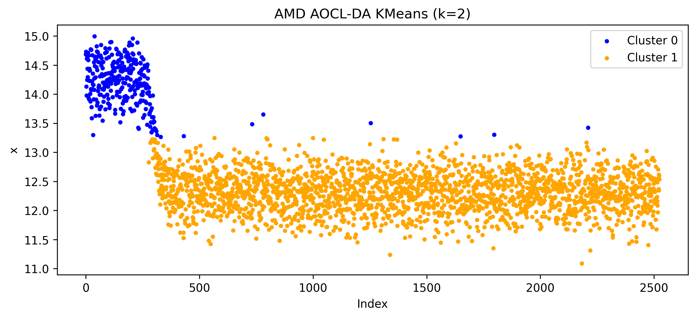
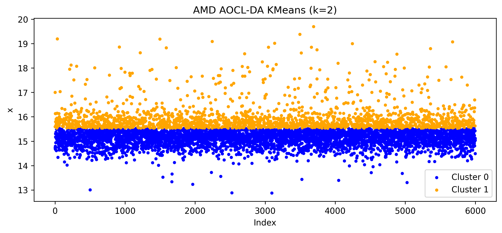
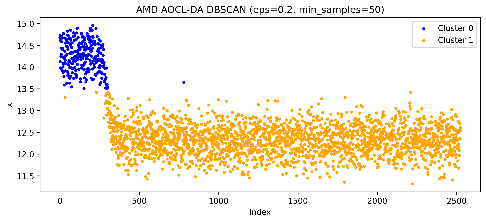
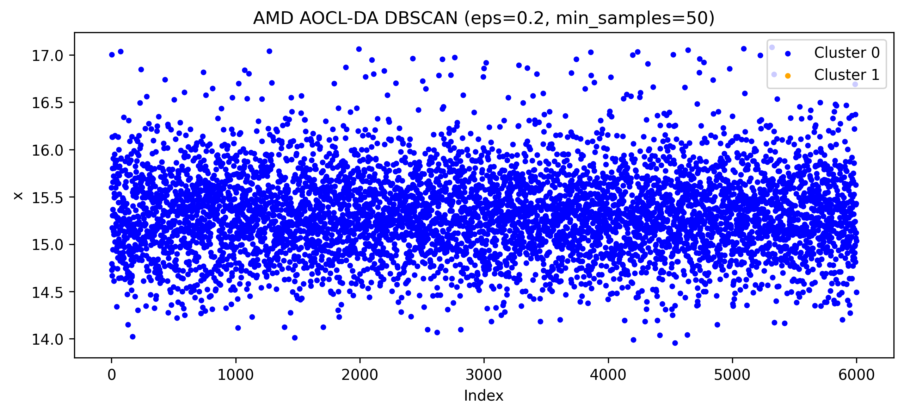
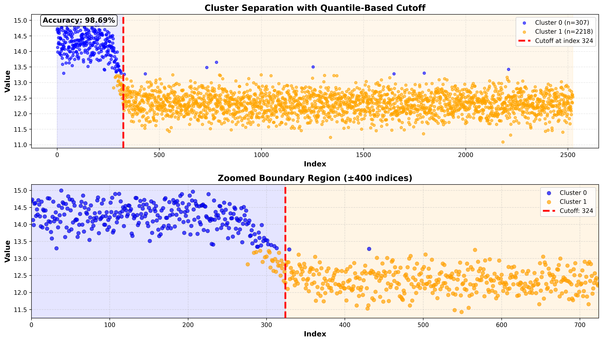
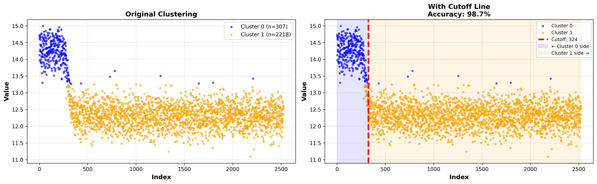
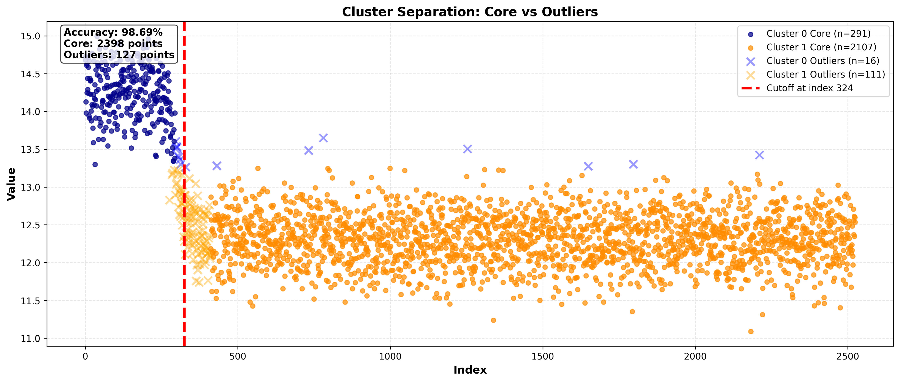
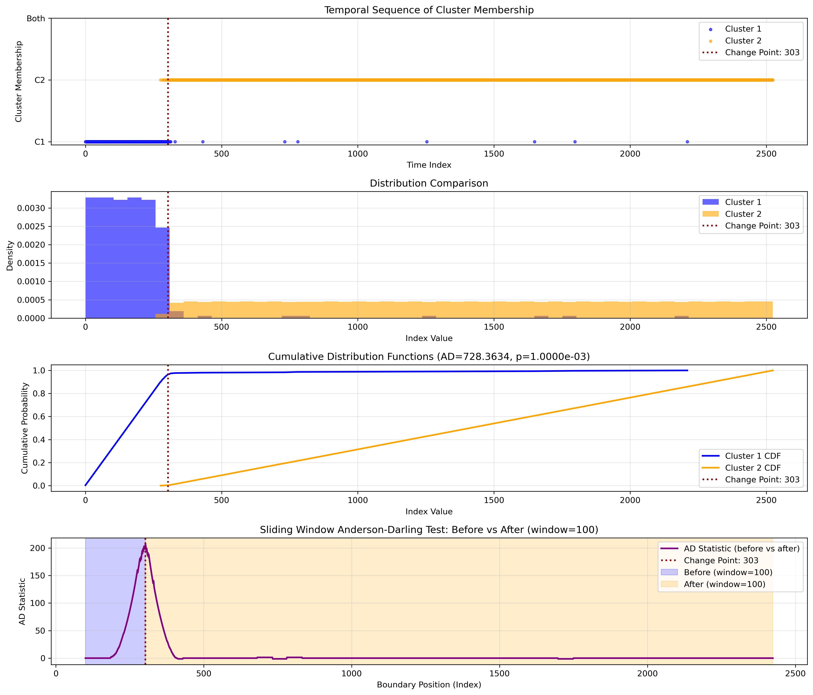
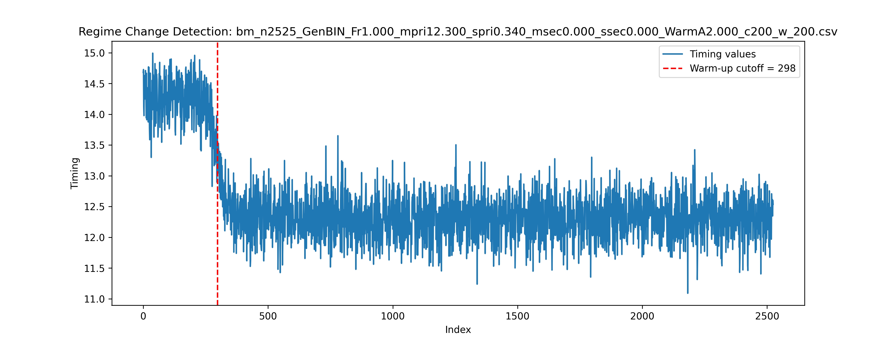
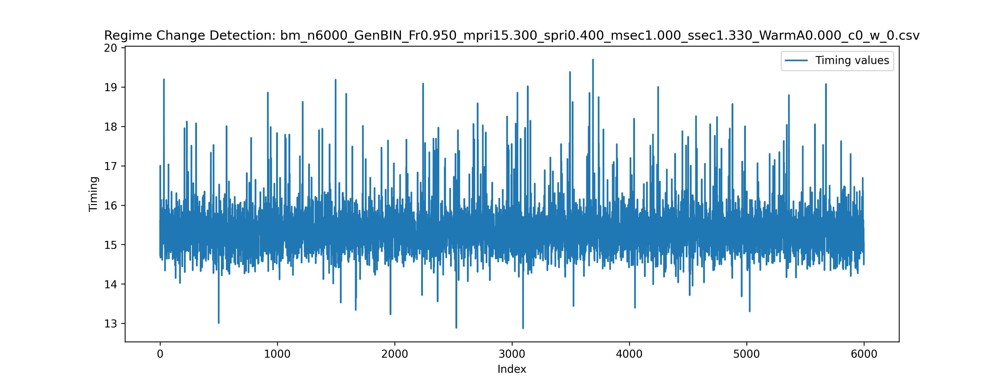

# CPU Benchmark Analysis: Statistical and Machine Learning Approaches

We developed a framework for identifying warm-up behaviour and assessing burn-in cutoffs in noisy, simulated benchmark timings. Our approach brings together exploratory data analysis, K-Means and DBSCAN clustering, quantile-based boundary estimation, Kolmogorov-Smirnov (KS) and Anderson-Darling (AD) tests, and an independent sliding-window mean-shift detector.

This is a collaborative group research project by six contributors. We jointly analysed the datasets, compared approaches, interpreted the results, and developed the conclusions presented here.

Our experiments produce closely aligned estimates for a clear early transition and show how complementary diagnostics distinguish warm-up behaviour from interleaved fast and slow measurements. We also characterise how gradual warm-up, overlapping timing distributions, and persistent mixtures affect each method. These findings provide practical guidance for interpreting a cutoff alongside the time series, cluster coverage, and behaviour of the retained samples.

## Table of Contents

- [Research Objectives](#research-objectives)
- [Data and Simulation Design](#data-and-simulation-design)
- [Repository Guide](#repository-guide)
- [Methodology](#methodology)
- [Exploratory Data Analysis and Inferences](#exploratory-data-analysis-and-inferences)
- [Clustering Results](#clustering-results)
- [Quantile Cutoff Results](#quantile-cutoff-results)
- [Kolmogorov-Smirnov (KS) and Anderson-Darling Results](#ks-and-ad-results)
- [Mean-Shift Detection Results](#mean-shift-detection-results)
- [Cross-Method Comparisons and Retained Data](#cross-method-comparisons-and-retained-data)
- [Conclusions](#conclusions)
- [Reproducing the Analysis](#reproducing-the-analysis)
- [Contributors and Roles](#contributors-and-roles)
- [Evidence and Attribition](#evidence-and-attribution)

## Research Objectives

Repeated API measurements can initially be slower than later measurements. Cache population, memory access behaviour, and prefetching provide practical motivation for investigating this warm-up period. Our data simulate such effects rather than measure their hardware causes directly.

We ask four questions:

1. Does a benchmark contain evidence of an initial warm-up transition?
2. Where do different approaches place a candidate burn-in cutoff?
3. When do clustering and statistical diagnostics agree, and what explains disagreements?
4. How much data would remain after a proposed cutoff, and does the retained region support further performance analysis?

For a series of length `n`, a cutoff `t` uses zero-based Python indexing. We discard `x[:t]` and retain `x[t:]`, leaving `n - t` observations. A detector returning `None` has not accepted a cutoff under its configured rules. This differs from proving that warm-up is absent.

Our implemented experiments focus on regime-change detection. The repository also includes paired comparison and within/between-run datasets that provide a foundation for extending this work. Completed results pipelines for those additional problem families remain outside the implemented scope.

## Data and Simulation Design

### Dataset Families

| Directory | Contents | Purpose and Implemented Coverage |
| --- | --- | --- |
| [data/regime_change](data/regime_change) | Nine single-column CSV time series and original plots. | Main experiments on warm-up and burn-in detection. |
| [data/change](data/change) | Sixteen CSV files arranged into eight paired comparisons. | Data for studying APIs, versions, or repeated runs. A completed comparison analysis is not included. |
| [data/within_between](data/within_between) | Three CSV files with ten benchmark columns each. | Data for studying within-run and between-run variability. A completed inference pipeline is not included. |

The regime-change CSVs contain a header named `x`, followed by timing measurements in arbitrary units. Sample index represents measurement order, rather than elapsed wall-clock time. All nine series contain numeric observations with no missing timings.

### Generating the Timing Distributions

[generators/clt.R](generators/clt.R) provides normal, shifted exponential, and two-component normal generators. It constructs observations, shuffles them with `sample(obs)`, and adds a deterministic warm-up signal. Interleaved high and low timings can therefore arise from a shuffled mixture without persistent temporal switching between hardware states.

- A normal generator produces a single Gaussian timing population.
- A shifted exponential generator produces `bump + Exp(rate)`, allowing asymmetric timings with a long upper tail.
- The binormal generator chooses a primary or secondary component for each generated benchmark block, then shuffles the pooled observations. The secondary mean is `mpri + msec`, so `msec` is an offset from the primary mean, rather than an absolute secondary mean.

`Fr` controls the probability of selecting the primary component at the block level. A finite dataset need not contain exactly that fraction of observations from each component. For example, the `Fr0.500` dataset with 1,800 measurements yields a saved K-Means partition of 1,200 and 600 points.

### Warm-Up Configurations

| Configuration | Filename Marker | Added Signal | Nominal Endpoint |
| --- | --- | --- | --- |
| Short, stronger warm-up | `WarmA2.000_c200_w_200` | Amplitude 2.0 for the initial 200 samples, then smooth decay over 200 samples. | After 400 samples. |
| Long, weaker warm-up | `WarmA0.760_c200_w_1300` | Amplitude 0.76 for the initial 200 samples, then smooth decay over 1,300 samples. | After 1,500 samples. |
| No added warm-up | `WarmA0.000_c0_w_0` | Zero added signal. | No warm-up endpoint. |

During decay, the generator uses `e = exp(s - 5)` for `s` spanning 0 to 10, and adds `(A / 2) * (1 - (e - 1) / (e + 1))`. It explicitly sets the added signal to zero after `c + w` samples.

The nominal endpoint and a detected change point capture different aspects of warm-up. A maximum-contrast detector can locate the steepest part of the decay before the added signal has completely disappeared. Agreement around that location supports transition localisation, while confirming the end of the entire transient requires a separate assessment.

### Regime-Change Dataset Index

We use these short labels throughout this README. The sample count and warm-up marker together identify each CSV in `data/regime_change`.

| Label | Samples | Timing Generator | Warm-Up | Start After The Full Simulated Transient |
| --- | ---: | --- | --- | ---: |
| N1800 | 1,800 | Binormal, primary mean 3.0, secondary offset 5.3 | Long, weaker | 1500 |
| N2000 | 2,000 | Shifted exponential, rate 0.8, bump 10.0 | Long, weaker | 1500 |
| N2210 | 2,210 | Binormal, primary mean 10.1, secondary offset 2.3 | None | 0 |
| N2525 | 2,525 | Single normal component, mean 12.3, SD 0.34 | Short, stronger | 400 |
| N2775 | 2,775 | Binormal, primary mean 10.3, secondary offset 2.0 | Long, weaker | 1500 |
| N3000-long | 3,000 | Binormal, primary mean 13.0, secondary offset 5.3 | Long, weaker | 1500 |
| N3000-short | 3,000 | Binormal, primary mean 13.0, secondary offset 5.3 | Short, stronger | 400 |
| N3668 | 3,668 | Binormal, primary mean 5.3, secondary offset 3.0 | Short, stronger | 400 |
| N6000 | 6,000 | Binormal, primary mean 15.3, secondary offset 1.0 | None | 0 |

The paired datasets cover GEMM version comparisons, TRSV version comparisons, `elastic` versus `kt`, and repeated vector workloads. [generators/within_between.R](generators/within_between.R) models ten repeated benchmarks with 100 timings each, shared run-level shifts, and occasional mixing of two populations. Its design illustrates how variation between runs can dominate variation within a run. These are simulation design features, rather than additional experimentally established conclusions from our burn-in pipeline.

## Repository Guide

```text
.
|-- data/
|   |-- regime_change/             Main timing series and original plots.
|   |-- change/                    Eight pairs of comparison datasets.
|   `-- within_between/            Repeated-run timing matrices.
|-- generators/
|   |-- clt.R                      Distribution and warm-up generators.
|   `-- within_between.R           Within/between-run simulator.
|-- src/
|   |-- bm_n1800.ipynb             EDA for N1800.
|   |-- bm_2525.ipynb              EDA for N2525.
|   |-- bm_n6000.ipynb             EDA for N6000.
|   |-- mean_shift_changepoint.ipynb
|   |-- AD_KS_Test.py
|   `-- problem1/
|       |-- kmeans_cluster.py
|       |-- dbscan_cluser.py
|       `-- aoclda-5.1.0-cp312-cp312-manylinux_2_35_x86_64.whl
|-- Quantile-Based-Cutoff/
|   |-- quantile_cluster_cutoff.py
|   `-- cutoff_*.png               Three saved cutoff visualisations.
|-- results/
|   |-- clustering_kmeans/         Per-dataset plots, arrays, and logs
|   |-- clustering_dbscan/         Per-dataset plots, arrays, and logs..
|   `-- regime_change/             Mean-shift plots for nine series.
|-- report/                        Analysis notes.
|-- requirements.txt
`-- README.md
```

| Implementation Fie | Responsibility |
| --- | --- |
| [bm_n1800.ipynb](src/bm_n1800.ipynb) | Data inspection, missing values, standardisation, distribution plots, rolling mean and variance, first differences, Q-Q plot, skewness, kurtosis, and IQR outliers |
| [bm_2525.ipynb](src/bm_2525.ipynb) | The same main EDA workflow applied to the clear warm-up example |
| [bm_n6000.ipynb](src/bm_n6000.ipynb) | Descriptive statistics, standardisation, distribution plots, rolling statistics, Q-Q plot, and IQR outliers for the no-warm-up control |
| [kmeans_cluster.py](src/problem1/kmeans_cluster.py) | Both K-Means backends, assignment plots, and saved cluster index arrays |
| [dbscan_cluser.py](src/problem1/dbscan_cluser.py) | Both DBSCAN backends, assignment plots, and exports of labels 0 and 1 |
| [quantile_cluster_cutoff.py](Quantile-Based-Cutoff/quantile_cluster_cutoff.py) | Temporal ordering of clusters, weighted quantile boundaries, separation scores, and three visualisations |
| [AD_KS_Test.py](src/AD_KS_Test.py) | Index-distribution tests, conditional temporal membership scans, diagnostic plots, and logs |
| [mean_shift_changepoint.ipynb](src/mean_shift_changepoint.ipynb) | Smoothing, strongest local timing decrease, acceptance rules, verification means, and output plots |

Standardised values created in the EDA notebooks are exploratory outputs. The clustering scripts read raw numeric CSV values directly and do not apply that standardisation.

## Methodology

### Step 1: Inspect the Input and Preserve Measurement Order

We load each timing series, inspect its shape and numerical contents, and check missing values. We preserve sample order throughout temporal analysis. We distinguish unusual values from invalid observations because a high timing may represent the warm-up effect we want to detect.

### Step 2: Establish Distributional and Temporal Behaviour With EDA

We examine box plots, histograms with kernel density estimates, raw timing traces, rolling statistics with a 50-sample window, and normal Q-Q plots. For N1800 and N2525, we also inspect first differences, skewness, and excess kurtosis. We use `Q1 - 1.5 * IQR` and `Q3 + 1.5 * IQR` as potential-outlier fences.

Distribution plots help identify mixtures and asymmetric tails. Time plots and rolling summaries help distinguish an early decline from variation that persists throughout a run. Together, these diagnostics guide method selection, with stationarity and independence requiring assessment beyond visual inspection and IQR rules.

For raw timings $x_0, \ldots, x_{n-1}$ and trailing window length $w = 50$, the EDA rolling mean is:

$$
\overline{x}_{t,w} = \frac{1}{w}\sum_{j=t-w+1}^{t}x_j
$$

The rolling sample variance used by the notebooks is:

$$
s_{t,w}^2 = \frac{1}{w-1}\sum_{j=t-w+1}^{t}\left(x_j-\overline{x}_{t,w}\right)^2
$$

These full-window expressions apply for $t \geq w-1$. The notebooks' default integer-window settings leave the first $w-1$ rolling values undefined. The variance denominator is $w-1$, matching the sample variance used by pandas, rather than the population variance used by the detector. See the [pandas rolling variance reference](https://pandas.pydata.org/pandas-docs/version/2.0/reference/api/pandas.core.window.rolling.Rolling.var.html).

First differences in the N1800 and N2525 notebooks are:

$$
\Delta x_t = x_t-x_{t-1}, \qquad t=1,\ldots,n-1
$$

The initial first difference is undefined because there is no preceding observation. Positive differences indicate increased timing, and negative differences indicate decreased timing.

### Step 3: Partition Timing Values With K-Means and DBSCAN

We apply both algorithms using scikit-learn and AMD AOCL-DA.

| Algorithm | Configuration In The Code | Interpretation |
| --- | --- | --- |
| K-Means | `n_clusters=2`, `n_init=10`, `max_iter=300`, `algorithm="lloyd"` | Seeks two timing groups even without warm-up. |
| scikit-learn K-Means | Also sets `random_state=42` | Controls its random initialisation. |
| AMD K-Means | No explicit random seed supplied. | Exact agreement with the other backend is not guaranteed. |
| DBSCAN | `eps=0.2`, `min_samples=50` by default. | Identifies dense timing regions and labels other points as noise. |

Sample index is not a clustering feature in these scripts. We cluster timing magnitudes, then inspect where assignments occur along the time axis. Cluster IDs are arbitrary and can swap across implementations. We infer early and late roles from temporal placement rather than assume cluster 0 always means warm-up.

The outputs `amd_cluster0.npy`, `amd_cluster1.npy`, `sklearn_cluster0.npy`, and `sklearn_cluster1.npy` contain zero-based observation indices, not timing values.

DBSCAN exports only labels 0 and 1, even if the model finds more clusters. An empty label-1 array makes the two-cluster downstream comparison unavailable. Observations absent from these exports may be noise or belong to an unexported cluster.

The K-Means objective is the within-cluster sum of squared Euclidean distances:

$$
\min_{C_0,C_1,c_0,c_1} J, \qquad J = \sum_{r=0}^{1}\sum_{i \in C_r}\lVert x_i-c_r\rVert_2^2
$$

$$
c_r = \frac{1}{|C_r|}\sum_{i \in C_r}x_i
$$

Here, $C_0$ and $C_1$ partition the observation indices and $c_r$ is a cluster centroid. Each $x_i$ is the numeric feature vector read from the CSV, which is a single timing value for our regime-change data. Lloyd's algorithm seeks a local solution to this objective, so the minimisation expression does not claim that each run reaches a global optimum. See the [scikit-learn K-Means formulation](https://scikit-learn.org/stable/modules/clustering.html#k-means).

For DBSCAN, define the neighbourhood as a set of observation indices so that repeated timing values still count as separate observations:

$$
\mathcal{N}_{\varepsilon}(i) = \lbrace j \in \lbrace 0,\ldots,n-1\rbrace \mid \lVert x_j-x_i\rVert_2 \leq \varepsilon \rbrace
$$

$$
\mathcal{C}_{\mathrm{core}} = \lbrace i \mid |\mathcal{N}_{\varepsilon}(i)| \geq m \rbrace
$$

Here, $\varepsilon$ is `eps` and $m$ is `min_samples`, with defaults 0.2 and 50. The neighbourhood includes the observation itself, matching the [scikit-learn DBSCAN definition](https://scikit-learn.org/stable/modules/generated/sklearn.cluster.DBSCAN.html).

A border observation is non-core and lies within a core observation's neighbourhood:

$$
i \in \mathcal{C}_{\mathrm{border}} \iff i \notin \mathcal{C}_{\mathrm{core}} \ \text{and}\ \exists j \in \mathcal{C}_{\mathrm{core}}: i \in \mathcal{N}_{\varepsilon}(j)
$$

Noise observations are outside both groups:

$$
\mathcal{C}_{\mathrm{noise}} = \lbrace 0,\ldots,n-1\rbrace \setminus \left(\mathcal{C}_{\mathrm{core}} \cup \mathcal{C}_{\mathrm{border}}\right)
$$

DBSCAN joins core observations through chains of neighbouring core observations and attaches eligible border observations. Its noise label is -1. These definitions describe model membership before the script exports only labels 0 and 1.

### Step 4: Estimate A Quantile-based Temporal Boundary

We order the two nonempty clusters by mean sample index. Let `L` occur earlier on average and `R` occur later. The default rule is:

```text
left_edge  = percentile(L, 95)
right_edge = percentile(R, 5)
gap        = right_edge - left_edge
cutoff     = round(left_edge + 0.25 * gap)
```

Percentiles reduce the influence of isolated extreme indices compared with using the last early-cluster point and first late-cluster point. The weight controls the location between the two edges.

In the notation of Equation (1), the weighted boundary is:

$$
\text{Cut-off} = L_{\mathrm{core}} + w\left(R_{\mathrm{core}} - L_{\mathrm{core}}\right)
$$

Here, $L_{\mathrm{core}}$ is the earlier cluster's 95th-percentile index, $R_{\mathrm{core}}$ is the later cluster's 5th-percentile index, and $w = 0.25$ by default. This is the interpolation formula. The implementation rounds its result to an integer index, as shown above.

We evaluate temporal separation as:

```text
agreement_percent = 100 * (
    count(L < cutoff) + count(R >= cutoff)
) / (len(L) + len(R))
```

The code calls this quantity accuracy. It measures agreement between a temporal split and the existing cluster assignments, rather than accuracy against independently labelled warm-up samples. For DBSCAN, the denominator includes only the two exported clusters.

If `gap` is negative, the percentile regions overlap in time. The code still returns an interpolated index, but this does not establish a clean burn-in boundary. Although `find_cutoff` accepts a `data` argument, its boundary calculation uses only the cluster indices.

### Step 5: Test Temporal Separation With KS and AD

We apply `scipy.stats.ks_2samp` and `scipy.stats.anderson_ksamp` to the two index arrays. The null hypothesis is that the samples have the same underlying distribution of index positions. We use `alpha = 0.05` as the decision threshold.

The two-sample KS statistic is the largest absolute difference between empirical CDFs. The AD k-sample statistic provides a complementary comparison with greater tail emphasis. The implemented AD procedure compares samples rather than testing a single sample for normality.

For the theoretical foundation, we present the following classical AD goodness-of-fit expression as Equation (2):

$$
A^2 = -n - \frac{1}{n}\sum_{i=1}^{n}(2i - 1)\left[\ln F\left(x_{(i)}\right) + \ln\left(1 - F\left(x_{(n+1-i)}\right)\right)\right]
$$

Here, $n$ is the sample size, $x_{(i)}$ is the observation in position $i$ of the sorted sample, and $F$ is the hypothesised theoretical CDF. The logarithmic terms describe sensitivity to both tails. We preserve the theoretical equation, while distinguishing it from the k-sample statistic returned by `anderson_ksamp` in our implementation.

This gives the corresponding classical KS goodness-of-fit expression as Equation (3):

$$
D_n = \sup_x\left|F_n(x) - F(x)\right| \approx \max_x\left|F_n(x) - F(x)\right|
$$

Here, $F_n(x)$ is the empirical CDF and $F(x)$ is the theoretical CDF. The supremum describes the greatest absolute separation. Our implemented `ks_2samp` comparison uses the empirical CDFs of the two index samples, as described above. Equations (2) and (3) provide theoretical context for the implemented sample-comparison procedures.

For the implemented two-sample KS comparison, let $u_1,\ldots,u_a$ and $v_1,\ldots,v_b$ be the two input samples. Their empirical CDFs and two-sided statistic are:

$$
F_a(z) = \frac{1}{a}\sum_{i=1}^{a}\mathbf{1}(u_i \leq z)
$$

$$
G_b(z) = \frac{1}{b}\sum_{j=1}^{b}\mathbf{1}(v_j \leq z)
$$

$$
D_{a,b} = \sup_z |F_a(z)-G_b(z)|
$$

The indicator $\mathbf{1}$ equals one when its condition holds and zero otherwise. Inputs are cluster indices in the global comparison and filtered membership values in the window scan. This explicitly compares two empirical distributions, matching the [SciPy two-sample KS test](https://docs.scipy.org/doc/scipy/reference/generated/scipy.stats.ks_2samp.html).

For the implemented AD comparison, we use the tie-aware midrank k-sample form. Let sample $r$ have size $n_r$, let $N = \sum_{r=1}^{k}n_r$, and let $z_1<\cdots<z_q$ be the distinct pooled values. Define $f_{rj}$ as the count of value $z_j$ in sample $r$, $l_j = \sum_{r=1}^{k}f_{rj}$ as its pooled count, and the midrank counts as:

$$
B_j = \sum_{h=1}^{j-1}l_h + \frac{l_j}{2}
$$

$$
M_{rj} = \sum_{h=1}^{j-1}f_{rh} + \frac{f_{rj}}{2}
$$

The unnormalised midrank statistic is:

$$
A_{k,N,\mathrm{mid}}^2 = \frac{N-1}{N}\sum_{r=1}^{k}\frac{1}{n_r}\sum_{j=1}^{q}\frac{l_j}{N}\frac{(N M_{rj}-n_r B_j)^2}{B_j(N-B_j)-N l_j/4}
$$

SciPy returns the normalised statistic:

$$
T_{\mathrm{AD}} = \frac{A_{k,N,\mathrm{mid}}^2-(k-1)}{s_{k,N}}
$$

Here, $s_{k,N}$ is the positive finite-sample null standard-deviation factor computed by the Scholz-Stephens normalisation from the sample sizes. It is distinct from timing SD. Our calls use $k=2$. The formula and normalisation follow [SciPy's midrank implementation](https://github.com/scipy/scipy/blob/v1.15.3/scipy/stats/_morestats.py#L2115-L2153) and its [normalisation calculation](https://github.com/scipy/scipy/blob/v1.15.3/scipy/stats/_morestats.py#L2327-L2338).

This k-sample expression supplements the one-sample Equation (2). It handles tied membership values explicitly and explains why the returned normalised statistic can be negative. The test requires nonempty samples and more than one distinct pooled value.

When a test returns `p < 0.05`, its own function proceeds to temporal localisation:

1. Build a continuous index range between the earliest and latest exported observations.
2. Encode membership as 0 for the first cluster, 1 for the second, 2 for overlap, and -1 for neither cluster.
3. Slide adjacent before and after windows of 100 indices each across that sequence.
4. Exclude -1 entries and require more than ten remaining observations in each window.
5. Compare the membership values with the corresponding test statistic.
6. Return the boundary at the maximum statistic as that method's candidate change point.

The global test compares temporal locations of cluster members. The windowed test compares local membership patterns. Neither directly tests raw timing distributions. A nonsignificant result means this procedure did not establish temporal separation, rather than proving that the timing populations are identical.

The scan selects the strongest observed contrast. It does not produce a cutoff confidence interval or adjust significance for searching many overlapping windows. Membership labels are discrete and tied, which also limits a literal interpretation of standard KS p-values.

### Step 6: Searching For A Decrease In Mean Timing

Our mean-shift change-point detector works on timing values without clustering. Here, mean shift describes a change in average timing. It is not the MeanShift clustering algorithm.

The moving-average smoothing in Equation (4):

$$
\text{Moving Average }(MA) = \frac{1}{|m_i|}\sum_{j \in m_i}^{n} x_j
$$

Here, $x_j$ is an individual timing value, $n$ is the series length, $k$ is the smoothing radius, and $|m_i|$ counts observations in the window at index $i$. Membership in $m_i$ defines the observations averaged by the implementation.

The window boundaries and membership are given as:

$$
\mathrm{start} \leftarrow \max(0, i-k), \qquad \mathrm{end} \leftarrow \min(n, i+k)
$$

$$
m_i = \lbrace j \mid \mathrm{start} \leq j < \mathrm{end} \rbrace
$$

Its left-hand and right-hand portions are:

$$
\mathrm{LHS}_i = \lbrace j \mid \mathrm{start} \leq j < i \rbrace = [\mathrm{start}, i)
$$

$$
\mathrm{RHS}_i = \lbrace j \mid i \leq j < \mathrm{end} \rbrace = [i, \mathrm{end})
$$

These intervals reproduce the smoothing-window definitions. The 200-sample before and after comparison windows used for detection are described separately in the steps below.

Equation (5) gives the accumulation over a selected interval:

$$
\mathrm{total} = \sum_{i=\mathrm{start}}^{\mathrm{end}-1}\mathrm{values}_i
$$

Here, $\mathrm{start}$ is inclusive, $\mathrm{end}$ is exclusive, and $\mathrm{values}_i$ is the value at index $i$. The implementation divides this total by the number of observations in the interval to obtain its mean.

Equation (6) defines the mean, population variance, and population standard deviation:

$$
\mu = \frac{1}{N}\sum_{i=1}^{N}x_i
$$

$$
\sigma^2 = \frac{1}{N}\sum_{i=1}^{N}(x_i-\mu)^2
$$

$$
\sigma = \sqrt{\sigma^2}
$$

Here, $N$ is the number of values used in the calculation. The detector applies these measures to the smoothed timings when estimating its reference variation. This population standard deviation is distinct from the sample SD reported in the descriptive statistics table.

To make the local calculations explicit, let $\widetilde{x}_i$ denote the smoothed timing at zero-based index $i$, let $n$ be the series length, and let $W=200$ be the comparison-window length. The local means are:

$$
\mu_{\mathrm{before}}(t) = \frac{1}{W}\sum_{i=t-W}^{t-1}\widetilde{x}_i
$$

$$
\mu_{\mathrm{after}}(t) = \frac{1}{W}\sum_{i=t}^{t+W-1}\widetilde{x}_i
$$

The detector's population mean and population SD over the full smoothed series are:

$$
\overline{x}_{\mathrm{s}} = \frac{1}{n}\sum_{i=0}^{n-1}\widetilde{x}_i
$$

$$
\sigma_{\mathrm{s}} = \sqrt{\frac{1}{n}\sum_{i=0}^{n-1}\left(\widetilde{x}_i-\overline{x}_{\mathrm{s}}\right)^2}
$$

These equations specialise Equation (6) to the detector's inputs. The global population SD $\sigma_{\mathrm{s}}$ supplies the reference variation for the relative-drop check, while local window means supply the directional contrast.

The local mean drop is defined as:

$$
D(t) = \mu_{\mathrm{before}}(t) - \mu_{\mathrm{after}}(t)
$$

We select the candidate $t$ that maximises $D(t)$ within the search range, then apply the acceptance checks below.

Explicitly, the candidate search set and selection rule are:

$$
\mathcal{T} = \lbrace t \in \mathbb{Z} \mid W \leq t < \min(n-W,\lfloor 0.8n\rfloor) \rbrace
$$

$$
t^{\ast} = \min\left(\mathop{\mathrm{argmax}}_{t \in \mathcal{T}} D(t)\right)
$$

The outer minimum selects the earliest index when several candidates share the maximum, matching the code's strict improvement update. Selection requires a nonempty search set and a positive maximum drop. The candidate becomes an accepted cutoff only after the remaining checks pass.

Using the default thresholds, the local-drop conditions are:

$$
D(t^{\ast}) \geq 0.25, \qquad D(t^{\ast}) \geq 0.4\sigma_{\mathrm{s}}
$$

For the global check, define $E = \max(W,\lfloor 0.2n\rfloor)$ and $L = \min(n-W,\lfloor 0.6n\rfloor)$. The required contrast is:

$$
\left|\frac{1}{E}\sum_{i=0}^{E-1}\widetilde{x}_i - \frac{1}{n-L}\sum_{i=L}^{n-1}\widetilde{x}_i\right| \geq 0.5
$$

These formulas describe the existing detector and retain the distinction between choosing a candidate with `argmax` and accepting it as a cutoff.

1. Reject series shorter than `2 * window_size + 10`, which is 410 samples under the defaults.
2. Smooth each sample over `[max(0, i - 20), min(n, i + 20))`. Interior moving-average windows contain 40 observations.
3. Compute the population standard deviation of the smoothed series.
4. Search splits from 200 up to, but excluding, `min(n - 200, int(0.8 * n))`.
5. Compare means of the 200 smoothed observations before and after each split.
6. Select the split with the largest positive `mean_before - mean_after`.
7. Require a drop of at least 0.25 and at least 0.4 times the smoothed standard deviation.
8. Require an absolute early/late mean difference of at least 0.5. The early range ends at `max(200, int(0.2 * n))`. The late range starts at `min(n - 200, int(0.6 * n))` and continues to the end.
9. Print a verification comparison using up to 300 smoothed observations on either side, then plot original timings with the accepted cutoff.

The final acceptance check uses an absolute early/late difference. The local search requires a decrease, but the global check does not independently enforce that the early mean is higher.

### Step 7: Compare Candidates and Inspect Retained Data

We compare indices, coverage, percentile overlap, and timing behaviour around each split. This comparison supports both transition interpretation and assessment of the retained data. The repository provides separate analytical components for this investigation, with automatic voting or consensus remaining a possible extension.

## Exploratory Data Analysis and Inferences

### Descriptive Statistics From the CSV Data

These values are recalculated from the current data. SD is sample standard deviation. Kurtosis is excess kurtosis, with a Gaussian reference of zero.

| Dataset | Mean | SD | Minimum | Maximum | Skewness | Excess kurtosis | IQR-flagged points |
| --- | ---: | ---: | ---: | ---: | ---: | ---: | ---: |
| N1800 | 5.1259 | 2.5346 | 2.3727 | 10.7222 | 0.7342 | -1.2920 | 0 |
| N2000 | 11.5626 | 1.2754 | 10.0009 | 22.8647 | 1.8926 | 6.3897 | 93 |
| N2210 | 11.7691 | 1.8666 | 4.6269 | 17.3876 | -0.6807 | 0.6534 | 65 |
| N2525 | 12.5480 | 0.7044 | 11.0897 | 14.9944 | 1.5943 | 2.1447 | 286 |
| N2775 | 10.5885 | 0.7308 | 8.4500 | 13.4941 | 0.6640 | 1.0221 | 75 |
| N3000-long | 16.1784 | 2.9653 | 9.6350 | 25.4140 | 0.0896 | -1.2100 | 0 |
| N3000-short | 16.3740 | 2.9989 | 10.1886 | 24.2743 | -0.0198 | -1.1424 | 0 |
| N3668 | 6.7521 | 1.6406 | 3.6566 | 10.5229 | 0.1400 | -1.3021 | 0 |
| N6000 | 15.3669 | 0.5697 | 12.8736 | 19.7000 | 1.7408 | 7.9724 | 223 |

The analysis gives an approximate N2525 SD of 0.58. The supplied CSV yields 0.7044, which is the value used here. We distinguish measurements from the current artifacts from narrative approximations.

### N1800: Timing Populations Without A Clean Temporal Division

Our [EDA notes](report/bm_n1800_EDA_results.md) describe a bimodal histogram, pronounced departures from a normal Q-Q line, substantial first-difference spikes, and a rolling mean that does not settle into a clearly flat trace. The observed quartiles are 3.1874 and 8.1707, with no points outside the IQR fences.

We infer that a single Gaussian summary hides important structure. Positive skewness and negative excess kurtosis are consistent with a broad mixture. The absence of IQR outliers simply means values fit inside wide mixture-based fences. It does not prove that the data are clean, stationary, or Gaussian.

High and low values recur throughout the series. This is consistent with the simulator's shuffled mixture and does not establish repeated persistent regime changes. The long warm-up is present by construction, but its amplitude of 0.76 is small relative to the overall SD of 2.5346. Timing clusters can recover mixture components without isolating an early transient.

### N2525: A Strong Early Decline

N2525 combines a single normal timing population with a stronger added warm-up signal. Early measurements lie near a higher level, then decline toward a stable-looking lower band. Rolling summaries support an early transition, making this our clearest cutoff comparison.

The 286 IQR-flagged observations should not automatically be removed. Much of the elevated early region represents the designed transient. Treating all of it as generic noise before analysis would remove part of the phenomenon under investigation.

### N6000: Stable Central Timing With Persistent Tail Events

This no-warm-up control has mean 15.3669 and SD 0.5697. Positive skewness, excess kurtosis of 7.9724, and 223 IQR-flagged points show that a stable central level can coexist with a long upper tail and occasional low values.

We infer that outliers and non-normality alone do not establish warm-up. A directional temporal pattern is needed. This control is useful because K-Means still creates two groups, while temporal testing and mean-shift do not accept an early boundary.

### Implications For Method Selection

EDA motivated complementary approaches rather than a blanket assumption of Gaussian, independent timings. Clustering exposes timing structure, temporal diagnostics assess its ordering, and smoothing makes directional trends easier to inspect. Formal autocorrelation analysis and stationarity tests are not implemented, so we do not claim the diagnostic plots establish either property.

## Clustering Results

### K-Means and Temporal Ordering



**Figure 1.** The higher-timing cluster is concentrated near the start, while the lower-timing cluster dominates later. The partition contains 307 and 2,218 points. This temporal concentration supports a candidate boundary despite a few late high values.



**Figure 2.** K-Means also produces two groups without added warm-up. Both extend across the run. Comparing Figures 1 and 2 shows why timing separation needs temporal validation before it can justify burn-in removal.

### DBSCAN and Exported Coverage



**Figure 3.** The two exported groups contain 287 and 2,231 points and are concentrated in different parts of the run. Seven observations are absent from the exports. The partition supports an early transition while reducing the influence of some sparse observations.



**Figure 4.** The exports contain one group of 5,875 points and an empty second group. The two-group cutoff workflow is unavailable. This is compatible with the lack of a clear early division, but a one-group result alone cannot prove absence of warm-up.

The following counts come from current AMD arrays. K-Means assigns every observation. DBSCAN coverage refers only to its two exported labels.

| Dataset | K-Means Cluster Sizes | DBSCAN Cluster Sizes | DBSCAN Exported Coverage |
| --- | --- | --- | ---: |
| N1800 | 1200 / 600 | 573 / 1200 | 98.50% |
| N2000 | 456 / 1544 | 1876 / 0 | 93.80% |
| N2525 | 307 / 2218 | 287 / 2231 | 99.72% |
| N2775 | 1092 / 1683 | 2714 / 0 | 97.80% |
| N3000-long | 1433 / 1567 | 2880 / 0 | 96.00% |
| N3668 | 1961 / 1707 | 118 / 1985 | 57.33% |
| N6000 | 4167 / 1833 | 5875 / 0 | 97.92% |

Clustering artifacts cover seven datasets. N2210 and N3000-short have mean-shift plots but no saved clustering directories.

After allowing swapped labels, the current backends agree exactly for K-Means on N1800, N2000, N2525, and N3668, and for DBSCAN on N1800, N2000, N2525, N2775, and N6000. Differences remain elsewhere. N3000-long has DBSCAN exports of 2,880 and 0 for AMD, versus 1,391 and 1,489 for scikit-learn. N3668 has DBSCAN exports of 118 and 1,985 for AMD, versus 118 and 1,484 for scikit-learn.

The artifacts do not establish that these differences arise solely from library implementation. Saved settings and provenance are incomplete. We also have no recorded execution-time study supporting a backend speed comparison.

## Quantile Cutoff Results

### Clear-Transition Example

For N2525, the results are reproduced by the saved AMD arrays:

| Input partition | Left 95th-percentile index | Right 5th-percentile index | Cutoff | Temporal agreement | Exported observations |
| --- | ---: | ---: | ---: | ---: | ---: |
| AMD K-Means | 295.40 | 410.85 | 324 | 98.69% | 2525 |
| AMD DBSCAN | 277.70 | 400.50 | 308 | 99.21% | 2518 |

Both partitions achieve strong temporal separation. DBSCAN's agreement is about 0.51 percentage points higher before rounding, and it uses seven fewer observations. This comparison demonstrates the quality of the cluster-derived separation, with relative accuracy against the true endpoint remaining a separate evaluation question.



**Figure 5.** The saved AMD K-Means example gives cutoff 324 and 98.69% agreement. The zoomed panel exposes transition-region overlap that is harder to see in the full trace.



**Figure 6.** The boundary makes the temporal interpretation explicit. It does not alter cluster assignments or remove residual overlap.



**Figure 7.** The plot identifies 2,398 core points and 127 percentile-tail points, including 16 from cluster 0 and 111 from cluster 1. Its term outliers refers to temporal percentile tails, which differ from IQR timing outliers and DBSCAN noise.

All three saved quantile figures show the same N2525 AMD K-Means experiment. The DBSCAN cutoff of 308 is reported numerically and reproduced from its arrays.

### Applying The Same Rule To All AMD Partitions

These additional values are recalculated from saved arrays with the default percentile and weight. They characterise the conditions under which the rule provides a useful temporal separator and where another diagnostic is needed.

| Dataset | K-Means Cutoff | K-Means Agreement | DBSCAN Cutoff | DBSCAN Agreement |
| --- | ---: | ---: | ---: | ---: |
| N1800 | 1301 | 58.50% | 1301 | 58.94% |
| N2000 | 1428 | 41.10% | Unavailable | Empty second export |
| N2525 | 324 | 98.69% | 308 | 99.21% |
| N2775 | 1986 | 53.59% | Unavailable | Empty second export |
| N3000-long | 2183 | 51.53% | Unavailable | Empty second export |
| N3668 | 2705 | 49.62% | 281 | 97.34% |
| N6000 | 4338 | 41.52% | Unavailable | Empty second export |

Every K-Means row except N2525 has a negative percentile gap. The DBSCAN N1800 gap is also negative. Identifying this overlap gives us a practical criterion for recognising outputs that should not be accepted as clean temporal boundaries.

N3668 illustrates the value of assessing agreement alongside coverage. AMD DBSCAN isolates a small early group with high agreement and exported coverage of 57.33%. K-Means groups remain interleaved, making quantile interpolation a poor separator in that case. The comparison clarifies why high conditional agreement and broad coverage are separate requirements.

## Kolmogorov-Smirnov (KS) and Anderson-Darling Results

### Global Index-Distribution Tests

These tables transcribe saved `ks_ad_analysis.log` files. They describe the logged experiments, rather than fresh statistical reruns on every current array.

| K-Means Dataset | KS Statistic | KS p-value | AD Statistic | AD p-value |
| --- | ---: | --- | ---: | --- |
| N1800 | 0.036667 | 0.650901 | -0.594579 | 0.25 |
| N2000 | 0.147021 | 4.161560e-07 | 15.118817 | 0.001 |
| N2525 | 0.967179 | 1.531604e-322 | 728.363404 | 0.001 |
| N2775 | 0.396280 | 1.908935e-93 | 259.219192 | 0.001 |
| N3000-long | 0.033680 | 0.353208 | -0.060003 | 0.25 |
| N3668 | 0.126893 | 2.866640e-13 | 43.884051 | 0.001 |
| N6000 | 0.016926 | 0.851270 | -0.760782 | 0.25 |

| DBSCAN Dataset | KS Statistic | KS p-value | AD Statistic | AD p-value |
| --- | ---: | --- | ---: | --- |
| N1800 | 0.038237 | 0.604434 | -0.541905 | 0.25 |
| N2525 | 0.990689 | 4.446591e-323 | 720.056687 | 0.001 |
| N3668 | 0.971788 | 4.120009e-150 | 332.172615 | 0.001 |

The other four DBSCAN logs record an empty second cluster and `nan` KS results. They stop before a completed AD result or comparison summary and provide no valid two-sample inference.

AD outputs of 0.001 and 0.25 are the reported tabulated lower and upper bounds in this testing mode, rather than precise probabilities. Extremely small KS values indicate strong separation under the test assumptions, rather than exact cutoff certainty.

### Localised Change Points

| Dataset | K-Means KS | K-Means AD | DBSCAN KS | DBSCAN AD |
| --- | ---: | ---: | ---: | ---: |
| N1800 | None | None | None | None |
| N2000 | 773 | 1292 | Unavailable | Unavailable |
| N2525 | 303 | 303 | 287 | 287 |
| N2775 | 834 | 834 | Unavailable | Unavailable |
| N3000-long | None | None | Unavailable | Unavailable |
| N3668 | 283 | 283 | 282 | 283 |
| N6000 | None | None | Unavailable | Unavailable |



**Figure 8.** Membership, index histograms, empirical CDFs, and the sliding AD statistic support a pronounced early division. The recorded maximum occurs at 303. These panels concern cluster membership and positions, rather than normality of raw timings.

For N2525, local KS maxima are 0.890000 for K-Means and 0.889184 for DBSCAN. Corresponding local AD maxima are 207.864152 and 205.278588. Both tests agree within each partition, while the clustering method shifts the candidate by 16 indices.

N2000 provides a useful sensitivity comparison, with KS at 773 and AD at 1292, a difference of 519 samples and the largest within-partition disagreement. Its long, weaker warm-up and skewed timings make a unique boundary less clear. The tests emphasise different aspects of membership distributions, helping us identify where endpoint evaluation is needed before selecting a preferred estimate.

N1800 and N3000-long demonstrate how temporal testing adds information to timing-based clustering. Their groups differ in magnitude, while the saved global tests do not establish temporal separation or proceed to localisation. This finding identifies mixture variation as a condition that can obscure known simulated warm-up.

## Mean-Shift Detection Results

These cutoffs are reproduced by evaluating the existing detector functions on each supplied CSV with default parameters. The before and after means use its separate 300-sample verification calculation on smoothed timings. They differ from the 200-sample search-window means used for acceptance.

| Dataset | Cutoff | Verification Mean Before | Verification Mean After | Verification Drop | Retained Observations |
| --- | ---: | ---: | ---: | ---: | ---: |
| N1800 | 490 | 5.6654 | 5.2113 | 0.4541 | 1310 |
| N2000 | 877 | 11.7176 | 11.4344 | 0.2832 | 1123 |
| N2210 | None | Not applicable | Not applicable | Not applicable | 2210 |
| N2525 | 298 | 14.2120 | 12.4288 | 1.7832 | 2227 |
| N2775 | 758 | 10.9845 | 10.6873 | 0.2972 | 2017 |
| N3000-long | 1851 | 16.2110 | 15.7256 | 0.4854 | 1149 |
| N3000-short | 325 | 18.0392 | 16.0420 | 1.9972 | 2675 |
| N3668 | 296 | 8.5094 | 6.6877 | 1.8217 | 3372 |
| N6000 | None | Not applicable | Not applicable | Not applicable | 6000 |

For `None`, the retained count assumes no samples are discarded on this detector's advice. It does not certify suitability for every downstream test.



**Figure 9.** Cutoff 298 lies near the steep decline. The verification mean falls by about 1.7832 timing units, supporting a substantial local improvement.



**Figure 10.** The detector retains this no-warm-up control without accepting a cutoff. Its directional and global checks distinguish persistent spikes from an accepted initial mean-drop boundary.

The detector demonstrates broad detection coverage on the supplied data, accepting candidates for all seven nonzero-warm-up series and rejecting both controls. These results reflect thresholds adjusted during development, with independent held-out evaluation remaining a next step.

The results also clarify the distinction between detecting warm-up and locating its full endpoint. N1800 returns 490 although its full added warm-up lasts until sample 1,500. N3000-long returns 1851, after that endpoint. These cases identify endpoint localisation in gradual transients as a specific opportunity for refinement beyond detecting a local decrease.

## Cross-Method Comparisons and Retained Data

### N2525: Agreement On The Transition Region

| Method | Cutoff | Discarded Samples | Retained Samples | Retained Share |
| --- | ---: | ---: | ---: | ---: |
| Quantile on AMD K-Means | 324 | 324 | 2201 | 87.17% |
| Quantile on AMD DBSCAN | 308 | 308 | 2217 | 87.80% |
| Logged KS/AD on K-Means | 303 | 303 | 2222 | 88.00% |
| Logged KS/AD on DBSCAN | 287 | 287 | 2238 | 88.63% |
| Mean-shift detector | 298 | 298 | 2227 | 88.20% |
| Full simulated warm-up endpoint | 400 | 400 | 2125 | 84.16% |

The five detected indices span 287 to 324, a range of 37 samples, or about 1.47% of the run. This supports consistent localisation of the pronounced transition region.

Every candidate is earlier than 400, after which the simulator removes the full warm-up signal. They retain between 76 and 113 observations preceding that endpoint. We describe them as transition estimates.

These retained counts describe contiguous slices of the original series. They differ from DBSCAN export counts. Choosing a temporal cutoff does not automatically remove later noise or other outliers.

### N6000: Agreement On The Absence Of An Accepted Boundary

K-Means produces two groups, but its logged KS p-value is 0.851270 and its AD output is at the 0.25 upper bound. Neither test localises a boundary. DBSCAN has one nonempty exported group, and mean-shift returns `None`.

Together, these findings support retaining the full run with respect to initial warm-up removal. The complementary diagnostics also identify the K-Means quantile output of 4338 as a poor separator through its negative gap and 41.52% agreement. This control demonstrates the value of checking numerical outputs before accepting a burn-in boundary.

### Gradual Warm-Up and Mixtures

- **N1800:** EDA shows a strong mixture. Neither clustering-based test accepts temporal separation, quantile agreement is weak, and mean-shift returns an early local decrease. Method agreement does not establish a reliable full endpoint.
- **N2000:** KS, AD, and mean-shift return 773, 1292, and 877. Their spread indicates ambiguity. K-Means percentile regions overlap, and AMD DBSCAN lacks a second nonempty export.
- **N2775:** Logged KS and AD agree at 834, while mean-shift returns 758. All are before the nominal endpoint of 1500. The quantile result of 1986 has weak agreement and overlapping percentile regions.
- **N3000-long:** Logged K-Means tests do not establish temporal separation, while mean-shift returns 1851. Current DBSCAN exports differ substantially across backends, limiting a combined interpretation.
- **N3668:** Logged test boundaries are 282 or 283, mean-shift gives 296, and AMD DBSCAN quantiles give 281. K-Means quantiles fail because its groups overlap throughout time. Local membership changes can identify a transition even when a global quantile separator is unsuitable.

### Interpretation Across Methods

The methods contribute complementary strengths. K-Means reveals timing structure, with temporal diagnostics needed to interpret its two groups as phases. DBSCAN can isolate phases, with density settings and export coverage guiding downstream interpretation. Quantiles provide interpretable boundaries for temporally separated groups, while overlap requires an external eligibility check because the method has no built-in rejection rule. KS and AD assess temporal structure, and mean-shift independently checks timing values.

Comparing these approaches gives us several views of the same transition. Agreement among clustering-derived methods is partly dependent because they share partitions, while mean-shift contributes an independent timing-based view shaped by smoothing and windows. We use agreement as corroboration and investigate disagreement explicitly, keeping interpretation grounded in the evidence rather than treating an average of all returned indices as a validated cutoff.

## Conclusions

We developed and compared complementary approaches for detecting warm-up in simulated API timings, producing both candidate boundaries and practical guidance for interpreting them. N2525 demonstrates consistent localisation of a pronounced early decline across the approaches. Our wider comparisons establish how distribution shape, temporal ordering, coverage, and diagnostic agreement inform burn-in assessment.

1. **EDA guides informed method selection.** Identifying bimodality, tail events, and broad IQR fences helps us distinguish timing populations from temporal phases. This establishes why distribution shape needs temporal context when assessing burn-in.
2. **Temporal diagnostics strengthen clustering.** K-Means splits the no-warm-up N6000 control, and temporal diagnostics help us interpret that split without accepting an unsupported early boundary.
3. **Quantile boundaries provide clear separation in suitable cases.** N2525 gives 98.69% and 99.21% agreement. Comparisons with interleaved mixtures establish when temporal overlap makes a returned index unsuitable.
4. **We distinguish transition localisation from complete warm-up removal.** Clear-transition estimates precede the simulator's endpoint, and gradual cases can be substantially early or late. This distinction gives endpoint evaluation a clear role in further refinement.
5. **Method comparisons reveal useful sensitivity information.** N2000's 519-sample KS/AD difference identifies behaviour that would be hidden by reporting one selected result.
6. **Coverage and provenance support transparent comparisons.** Reporting DBSCAN's omitted observations and differences between some logs and current arrays gives readers the context needed to assess the evidence.
7. **Independent checks strengthen interpretation.** Direct mean-shift analysis complements clustering-derived diagnostics, especially for interleaved timing groups.

Our findings provide a foundation for proposing and assessing warm-up transitions, with clear evidence of where the approaches agree and where further investigation is valuable. Establishing a universally optimal burn-in rule, a minimum sufficient benchmark duration, and an automatic guarantee of steady state remains beyond the demonstrated scope.

## Reproducing The Analysis

### 1. Inspect The Saved Evidence

CSV files, PNGs, NPY index arrays, and logs can be inspected without a full rerun. The embedded figures use relative repository paths and are available directly on GitHub.

### 2. Prepare A Compatible Python Environment

The bundled AOCL-DA wheel targets CPython 3.12, Linux x86-64, and `manylinux_2_35`. That wheel cannot be installed on native Windows or macOS. Use a compatible Linux environment with glibc 2.35 or newer and any required AOCL runtime libraries configured.

From the repository root in that environment:

```bash
python3.12 -m venv .venv
source .venv/bin/activate
python -m pip install -r requirements.txt
python -m pip install jupyter ipykernel
python -m pip install src/problem1/aoclda-5.1.0-cp312-cp312-manylinux_2_35_x86_64.whl
```

[requirements.txt](requirements.txt) lists pandas, NumPy, SciPy, Matplotlib, seaborn, scikit-learn, and wandb. Jupyter and AOCL-DA require the separate steps above. The analysis code does not require a wandb login. Versions are not pinned, so installing dependencies does not guarantee exact reproduction of historical outputs.

Both clustering modules import AOCL-DA at module scope. A working AOCL installation is required to import either unchanged module, including when using its scikit-learn functions.

### 3. Run the EDA Notebooks

```bash
jupyter notebook
```

Use a kernel working directory of `src/` for `bm_n1800.ipynb` and `bm_2525.ipynb`, whose CSV paths start with `../data/`. Use the repository root for `bm_n6000.ipynb`, whose path starts with `data/`. Check the kernel directory with `Path.cwd()`.

These are exploratory notebooks. Some N1800 and N2525 cells refer to `df.describe`, `df.info`, or `plt.show` without calling them. Those expressions do not execute the operation. This README's statistics were calculated from the CSVs directly.

### 4. Run The Default Clustering Experiments

From the repository root:

```bash
python src/problem1/kmeans_cluster.py
python src/problem1/dbscan_cluser.py
```

Both scripts hard-code N6000 at the bottom, run both backends, and overwrite matching outputs in the dataset's results directory. They do not accept a dataset filename argument or automatically process all nine files.

Importing either module also runs its bottom-level N6000 example. Existing functions accept other CSV paths. For example, the following interactive code runs N2525 K-Means after that import side effect:

```python
from pathlib import Path
from src.problem1.kmeans_cluster import kmeans_amd, kmeans_sklearn

csv = next(Path("data/regime_change").glob("bm_n2525_*.csv"))
amd_groups = kmeans_amd(str(csv))
sklearn_groups = kmeans_sklearn(str(csv))
```

DBSCAN functions are `dbscan_amd` and `dbscan_sklearn` in `src.problem1.dbscan_cluser`. Match arrays to the exact CSV stem. Preserve historical outputs before rerunning if you need the original evidence.

### 5. Run The Quantile Demonstration

The demonstration reads existing N2525 AMD K-Means arrays and resolves inputs relative to its script location. Run it from its own directory to write the three PNG outputs there:

```bash
cd Quantile-Based-Cutoff
python quantile_cluster_cutoff.py
cd ..
```

It reports the cutoff, percentile edges, agreement, and per-cluster counts. Other experiments can use `find_cutoff` and `evaluate_cutoff` with matching, nonempty arrays. Inspect the percentile gap before accepting a boundary.

### 6. Run An Eligible KS/AD Comparison

The current `AD_KS_Test.py` driver scans DBSCAN directories, selects scikit-learn arrays, uses 100-index windows, and overwrites diagnostic logs and plots. It checks file existence but does not skip empty clusters, so an unchanged run can stop on an ineligible dataset.

For a complete example without editing source, run this in a Python session from the repository root:

```python
from pathlib import Path
import numpy as np
from src.AD_KS_Test import kolmogorov_smirnov_test, anderson_darling_test

folder = next(Path("results/clustering_kmeans").glob("bm_n2525_*"))
file0 = folder / "sklearn_cluster0.npy"
file1 = folder / "sklearn_cluster1.npy"
assert np.load(file0).size > 0 and np.load(file1).size > 0

ks_result = kolmogorov_smirnov_test(str(file0), str(file1), window_size=100)
ad_result = anderson_darling_test(str(file0), str(file1), window_size=100)
print(ks_result)
print(ad_result)
```

The functions save PNGs beside the input arrays, display figures, and return dictionaries. Choose a suitable Matplotlib backend for your environment. The standalone driver handles text-log redirection.

### 7. Run Mean-Shift Detection

Open [mean_shift_changepoint.ipynb](src/mean_shift_changepoint.ipynb) and execute cells in order. Its path setup supports a kernel directory at the repository root or `src/`. The final driver processes every regime-change CSV, prints accepted cutoffs or no-detection messages, and writes figures to `results/regime_change`.

Compare outputs with the nine-row table, and inspect timing traces and verification means. The notebook returns one accepted cutoff per series rather than segmenting every possible regime change.

### 8. Treat Data Generation As A Separate Experiment

Our results use the supplied CSVs. Rerunning generators creates new draws and is unnecessary for analysing the existing data.

`clt.R` has driver flags for writing dataset families. Its active demonstration plots one generated series, while the regime-change and paired-comparison write flags are false. It does not set a fixed random seed. `within_between.R` sets seed 2026 and writes selected outputs into the current working directory. Review the drivers and keep new draws separate from the supplied files.

## Contributors and Roles

All six contributors analysed data, interpreted visualisations, compared methods, discussed limitations, and formed the research conclusions. These roles describe complementary responsibilities and code ownership rather than a ranking of contributions.

| Contributor | Implementation ownership and project role |
| --- | --- |
| [Satyaki Saha](https://github.com/sahasatyaki) | Author of [Mean Shift Change-point Detection Algorithm](src/mean_shift_changepoint.ipynb). Performed EDA and developed descriptive mean-shift detection and collaborated on cross-method analysis. |
| [Yulian Shkrum](https://github.com/yshkrum) | Author of the [K-Means](src/problem1/kmeans_cluster.py) and [DBSCAN](src/problem1/dbscan_cluser.py) code. Developed clustering experiments.|
| [Ashwin Sasikumar](https://github.com/ashwin0306) | Author of [Statistical Analysis](src/AD_KS_Test.py). Performed EDA and developed inferential tests and temporal membership analysis. |
| [Jacinth Mahanta](https://github.com/GitSentinel) | Contributed exploratory analysis, data visualisations, and interpretation of benchmark behaviour with the full team. Explored the application of the framework on Skin Segmentation benchmark|
| [Anuj K. Ladkat](https://github.com/anuj-ladkat) | Author of [Quantile-based Cutoff Algorithm](Quantile-Based-Cutoff/quantile_cluster_cutoff.py). Developed quantile boundaries and supported data preparation and management. |
| [Khwahish Sheikh](https://github.com/KhwahishSheikh) | Contributed exploratory analysis, data visualisations, and interpretation of benchmark behaviour with the full team. |

## Evidence and Attribition

This combines our implementations, supplied data, cluster arrays, logs, and figures. Numeric provenance is identified in the results sections:

- Descriptive statistics come from current CSVs.
- Cluster counts, backend comparisons, and supplementary quantile calculations come from current NPY arrays.
- KS/AD statistics and localised boundaries come from saved logs.
- Mean-shift cutoffs and verification means are reproduced from existing notebook functions with default parameters.
- All ten figures are existing repository images with captions describing their evidence.

Browse the full [K-Means artifacts](results/clustering_kmeans), [DBSCAN artifacts](results/clustering_dbscan), [mean-shift plots](results/regime_change), and [quantile artifacts](Quantile-Based-Cutoff) to understand the evidence.

The R generators carry Advanced Micro Devices, Inc. copyright notices and redistribution terms, which remain in their source files. AMD-provided simulation code and AOCL-DA identify our data and tool provenance and do not imply endorsement of this project. The project was further facilitated under the supervision of Dr Hansi Hettiarachchi (Academic Supervisor) and Dr. Edvin Hopkins (Industry Supervisor).